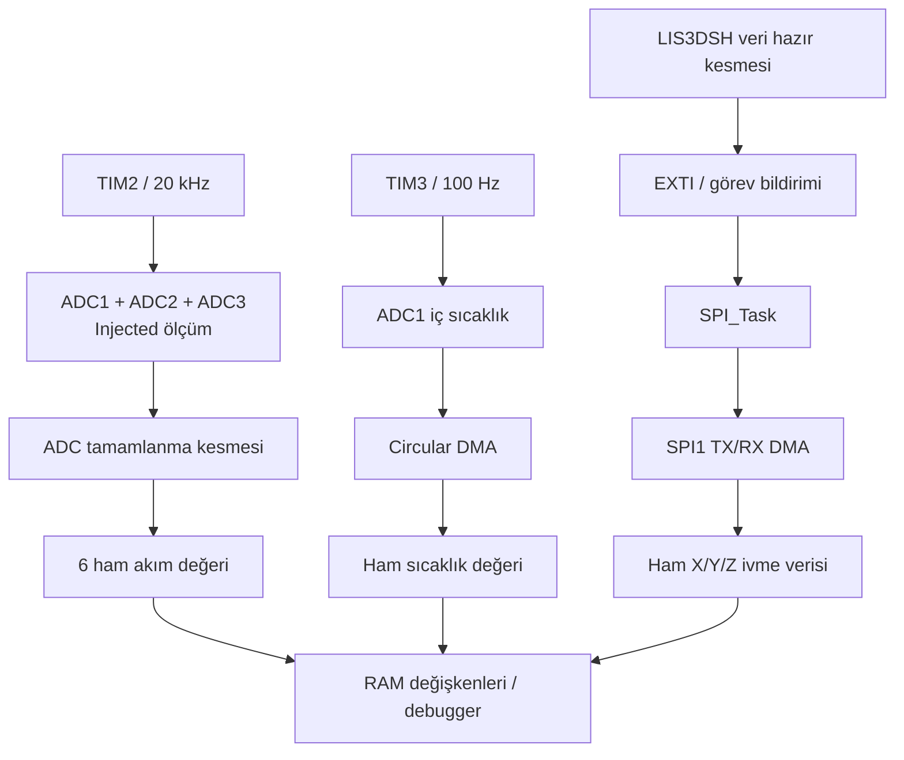

# STM32F407 — 6 Kanal ADC ve SPI İvmeölçer / FreeRTOS

STM32F407VG üzerinde **altı analog akım girişini, MCU iç sıcaklık kanalını ve LIS3DSH üç eksenli ivmeölçerini** okuyan gerçek zamanlı veri toplama projesi. STM32 HAL ile geliştirilmiştir; görev yönetimi FreeRTOS ve CMSIS-RTOS v2 üzerinden yürütülür.

## Projenin amacı

Projenin amacı, üç motor için ayrılmış ikişer akım girişini düzenli aralıklarla örneklemek ve bu ölçümlerin yanında sıcaklık ile ivme verisini toplamaktır. ADC zamanlaması donanım timer'larıyla, sürekli ivmeölçer okuması ise veri hazır kesmesi ve SPI DMA ile gerçekleştirilir.

Bu altyapı, ileride eklenecek motor kontrolü ve FOC (alan yönlendirmeli kontrol) hesaplarına ölçüm verisi sağlamak için hazırlanmıştır. **Mevcut sürüm veri toplama aşamasındadır; FOC hesapları ve motor sürme/PWM çıkışları henüz uygulanmamıştır.**

Repo adında IMU ifadesi kullanılsa da mevcut sensör LIS3DSH ivmeölçeridir; kod yalnızca X/Y/Z ivme verisini okur. Jiroskop veya yönelim hesabı içermez.

## Mevcut özellikler

| Özellik | Uygulama |
|---|---|
| 6 kanal akım girişi | ADC1/ADC2/ADC3 üzerinde ikişer injected kanal; triple injected simultaneous modu |
| Akım örnekleme zamanlaması | TIM2 TRGO ile kanal başına nominal **20 kHz** |
| MCU iç sıcaklık ölçümü | ADC1 regular kanal; TIM3 TRGO ile nominal **100 Hz**; circular DMA |
| 3 eksenli ivme okuma | LIS3DSH INT1 → EXTI → görev bildirimi → SPI1 TX/RX DMA |
| Sensör yapılandırması | 1600 Hz veri üretim ayarı; 7 baytlık DMA okuma çerçevesi |
| ADC hız takibi | Sayaç farklarından hesaplanan akım ve sıcaklık örnekleme hızları |
| Hata takibi | Sensör kimliği, DRDY/DMA/örnek sayaçları ve aktarım hata sayaçları |

Frekanslar yapılandırmadan hesaplanan nominal değerlerdir. Sensörün 1600 Hz ayarı, uygulamanın bütün örnekleri kayıpsız işlediği anlamına gelmez; gerçek hız kart üzerinde ölçülmelidir.

## Mimari



Akım örnekleme periyodunu RTOS görevleri yerine TIM2 belirler. Her ADC kendi iki kanalını sırayla dönüştürür; üç ADC'nin karşılık gelen rank'ları birlikte çalışacak şekilde yapılandırılmıştır. Altı kanalın tamamı tek anda örneklenmiş kabul edilmemelidir.

| RTOS görevi | Sorumluluk |
|---|---|
| `defaultTask` | ADC örnekleme hızlarını periyodik günceller |
| `SPI_Task` | Sensörün DRDY bildirimini bekler, DMA okumasını başlatır ve tamamlanmasını bekler |
| `Monitor_Task` | İzleme için ayrılmış iskelet görev; şu an yalnızca bekler |

## Donanım ve bağlantılar

- **MCU:** STM32F407VG
- **Sensör:** LIS3DSH üç eksenli ivmeölçer
- **Geliştirme ortamı:** STM32CubeIDE, STM32 HAL, FreeRTOS / CMSIS-RTOS v2
- **Nominal çekirdek saati:** 168 MHz; mevcut kaynak kodda HSI + PLL

| İşlev | Pinler |
|---|---|
| Motor 1 için ayrılmış analog girişler | PA1 / ADC1_IN1, PC1 / ADC1_IN11 |
| Motor 2 için ayrılmış analog girişler | PC4 / ADC2_IN14, PC5 / ADC2_IN15 |
| Motor 3 için ayrılmış analog girişler | PC2 / ADC3_IN12, PA2 / ADC3_IN2 |
| SPI1 SCK / MISO / MOSI | PA5 / PA6 / PA7 |
| LIS3DSH CS | PE3 |
| LIS3DSH INT1 / EXTI0 | PE0 |
| MCU sıcaklık kanalı | İç bağlantı; harici pin kullanılmaz |

Analog girişlerin hangi motor fazlarına bağlandığı ve akım algılama devresinin kazancı kodda tanımlı değildir. Pin ve çevre birimi ayarlarının kaynağı [25_09_V3.ioc](25_09_V3.ioc) dosyasıdır.

## Projeyi açma ve çalıştırma

1. Repoyu klonlayın:

   ```bash
   git clone https://github.com/gumskadirr/STM32F407_6CH-ADC_IMU-SPI_FREERTOS.git
   ```

2. STM32CubeIDE'de **File → Import → General → Existing Projects into Workspace** yoluyla klonlanan klasördeki `25_09_V3` projesini içe aktarın.
3. **Debug** yapılandırmasını seçip projeyi derleyin. HAL ve FreeRTOS kaynakları repo içinde bulunur.
4. Hedef kartı ve debug bağlantısını hazırlayıp `25_09_V3.launch` yapılandırmasını kendi bağlantınıza göre kullanın.
5. Debugger'da aşağıdaki RAM değişkenlerini izleyin:

   | Değişken | İçerik |
   |---|---|
   | `adc_current_raw[0..5]` | En son altı ham ADC ölçümü |
   | `temperature_raw` | MCU iç sıcaklık kanalının ham ADC ölçümü |
   | `adc_current_hz`, `adc_temperature_hz` | Hesaplanan ADC örnekleme hızları |
   | `accelData.x`, `.y`, `.z` | En son işaretli 16 bit ham ivme verisi |
   | `sensorDebug` | Sensör register değerleri, olay ve hata sayaçları |

## Mevcut sınırlar

- Akım, sıcaklık ve aktif DMA yolundaki ivme değerleri ham veridir; amper, °C, g veya m/s² dönüşümü uygulanmaz.
- Yalnızca en son ölçümler RAM'de tutulur. Örnek geçmişi, veri kaydı veya UART/CAN üzerinden aktarım yoktur.
- Thread flag'leri olay kuyruğu değildir; arka arkaya gelen sensör bildirimleri birleşebilir.
- Sensör görevinde aktarım hatası veya timeout sonrası görev sonlandırılır; otomatik yeniden başlatma uygulanmamıştır.
- Yeni bir veri tüketicisi eklenirken çok alanlı ADC/XYZ ölçümlerinin tutarlı bir kopyasını alma ihtiyacı değerlendirilmelidir.

## Kaynak kod ve ayrıntılı dokümantasyon

| Konum | İçerik |
|---|---|
| [Core/Src/main.c](Core/Src/main.c) | Başlatma, görevler ve ölçüm callback'leri |
| [Core/Src/lis3dsh.c](Core/Src/lis3dsh.c) | LIS3DSH register erişim sürücüsü |
| [Core/Inc/lis3dsh.h](Core/Inc/lis3dsh.h) | Register tanımları, veri yapıları ve görev flag'leri |
| `Drivers/` | STM32 HAL ve CMSIS kaynakları |
| `Middlewares/` | FreeRTOS kaynakları ve CMSIS-RTOS v2 uyarlaması |

Fonksiyon rehberi, açılış sırası, DMA/kesme eşleştirmeleri, senkronizasyon ve bakım notları için [Repo Dokümantasyonu](REPO_DOKUMANTASYONU.md) dosyasına bakın. Bu ayrıntılı doküman 7 Ekim 2026 tarihli incelemeyi içerir.

`Debug/`, `Release/` ve `.build/` dizinleri üretilen çıktılardır ve Git'e dahil edilmez. Projeye dahil HAL, CMSIS ve FreeRTOS bileşenlerinin lisans bildirimleri kendi dizinlerinde korunur.
