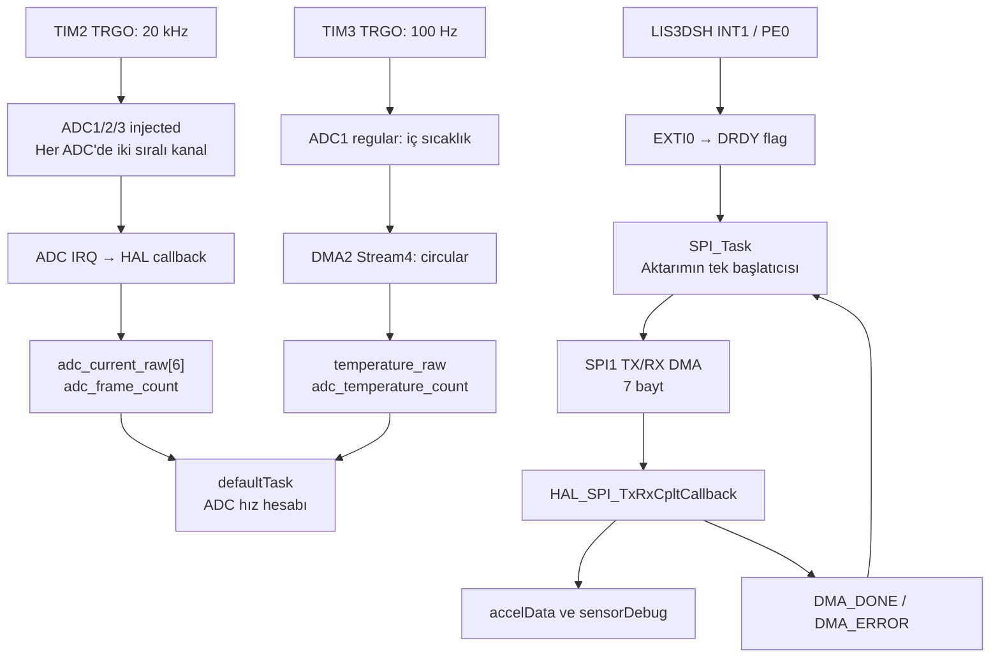
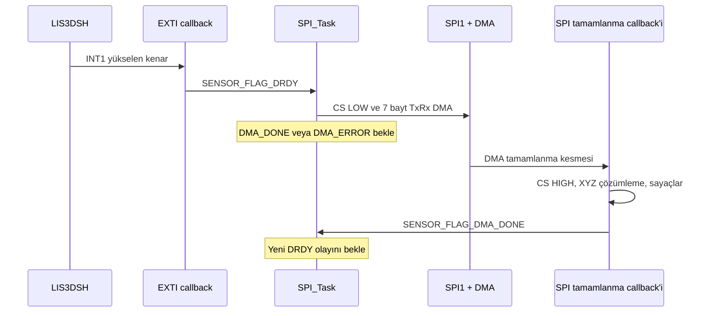

# 25_09_V3 — Proje, fonksiyonlar ve mimari

**İnceleme tarihi:** 7 Ekim 2026  
**Hedef:** STM32F407VG / STM32 HAL / STM32CubeIDE  
**Kapsam:** Mevcut kaynak kod, CubeMX yapılandırması ve Debug derlemesi.

Bu doküman kodun bugün yaptığı işleri açıklar. Kaynak yorumlarında belirtilen gelecek çalışmalar ayrıca işaretlenmiştir. Frekanslar, aksi belirtilmedikçe yapılandırmadan hesaplanan nominal değerlerdir; kart üzerinde ölçüm sonucu değildir.

## 1. Proje ne iş yapıyor?

Proje, STM32F407VG üzerinde çalışan bir gerçek zamanlı veri toplama altyapısıdır. Üç motor için ayrılmış altı analog akım girişini, MCU'nun iç sıcaklık kanalını ve LIS3DSH üç eksenli ivmeölçerini okur. Uygulama FreeRTOS üzerinde CMSIS-RTOS v2 API'sini kullanır.

| İşlev | Mevcut davranış | Sonucun bulunduğu yer |
|---|---|---|
| Altı akım girişini örnekleme | ADC1/2/3 injected grupları; TIM2 tetiklemesi; kanal başına nominal 20 kHz | `adc_current_raw[6]` |
| MCU iç sıcaklık kanalını örnekleme | ADC1 regular grubu; TIM3 tetiklemesi; nominal 100 Hz; circular DMA | `temperature_raw` |
| Üç eksenli ivme okuma | Sensörün veri hazır kesmesiyle SPI1 üzerinden 7 baytlık DMA aktarımı | `accelData.x/y/z` |
| ADC örnekleme hızını izleme | En az bir saniyelik sayaç farkından Hz hesabı | `adc_current_hz`, `adc_temperature_hz` |
| Sensör hata ve olaylarını izleme | DRDY, DMA, örnek ve hata sayaçları | `sensorDebug` |

Akım değerleri ADC'nin ham sayısal çıktılarıdır; amper dönüşümü, ofset kalibrasyonu ve filtreleme uygulanmaz. Sıcaklık değeri de ham ADC çıktısıdır; °C dönüşümü yoktur. Aktif DMA yolunda ivme değerleri işaretli 16 bit ham veridir; g veya m/s² dönüşümü yapılmaz.

Kaynak yorumları üç motor için FOC (alan yönlendirmeli kontrol) hesaplarının ileride ekleneceğini söylüyor. Mevcut kodda FOC, motor PWM üretimi, hız/konum kontrol döngüsü veya motor sürme işlemi bulunmuyor. UART/CAN üzerinden dışarı veri aktarımı, kayıt sistemi ve sensör FIFO işleme akışı da uygulanmış değil. Veriler RAM değişkenleri üzerinden debugger ile izlenmeye uygun durumda.

## 2. Dizinler ve modül sorumlulukları

| Dosya / dizin | Sorumluluk |
|---|---|
| [Core/Src/main.c](Core/Src/main.c) | Başlatma, çevre birimi yapılandırmaları, görevler, ADC/SPI/GPIO callback'leri ve ortak ölçüm değişkenleri |
| [Core/Inc/main.h](Core/Inc/main.h) | HAL dahil etme, CS ve sensör INT1 pin tanımları, `Error_Handler` bildirimi |
| [Core/Src/lis3dsh.c](Core/Src/lis3dsh.c) | Özel LIS3DSH sürücüsü; bloklayan register okuma/yazma ve yardımcı okuma fonksiyonları |
| [Core/Inc/lis3dsh.h](Core/Inc/lis3dsh.h) | Register adresleri, sürücü API'si, veri yapıları, DMA çerçeve uzunluğu ve görev flag'leri |
| [Core/Src/stm32f4xx_it.c](Core/Src/stm32f4xx_it.c) | Donanım kesmelerini ilgili HAL handler'ına yönlendirme |
| [Core/Src/stm32f4xx_hal_msp.c](Core/Src/stm32f4xx_hal_msp.c) | Çevre birimi saatleri, analog/alternatif fonksiyon pinleri, DMA eşleştirmeleri ve ADC NVIC ayarları |
| [Core/Src/stm32f4xx_hal_timebase_tim.c](Core/Src/stm32f4xx_hal_timebase_tim.c) | HAL için TIM6 tabanlı 1 ms zaman tabanı |
| [Core/Inc/FreeRTOSConfig.h](Core/Inc/FreeRTOSConfig.h) | RTOS tick, heap, öncelikler ve etkin API seçenekleri |
| [Core/Src/freertos.c](Core/Src/freertos.c) | Üretilmiş FreeRTOS iskeleti; mevcut uygulama görevleri burada değil, `main.c` içinde |
| `Core/Startup/startup_stm32f407vgtx.s` | Reset başlangıcı ve kesme vektör tablosu |
| `Core/Src/system_stm32f4xx.c` | CMSIS sistem başlangıcı ve sistem saat bilgisi |
| `Core/Src/sysmem.c`, `syscalls.c` | C çalışma zamanı için heap ve sistem çağrısı uyarlamaları; tek başına çalışan bir seri port altyapısı oluşturmaz |
| `Drivers/` | Projeye dahil STM32 HAL, CMSIS çekirdek ve MCU tanımları |
| `Middlewares/Third_Party/FreeRTOS/` | FreeRTOS çekirdeği, CMSIS-RTOS v2 uyarlaması, ARM_CM4F portu ve `heap_4` |
| [25_09_V3.ioc](25_09_V3.ioc) | CubeMX çevre birimi, pin, saat ve görev yapılandırması |
| `.project`, `.cproject`, `25_09_V3.launch` | CubeIDE proje, derleme ve debug ayarları |
| `STM32F407VGTX_FLASH.ld`, `STM32F407VGTX_RAM.ld` | Flash/RAM bağlama betikleri; mevcut Debug hedefi FLASH betiğini kullanır |
| `Debug/` | Üretilmiş makefile'lar, nesne dosyaları, ELF, map ve disassembly çıktıları |

Mimari mantıksal olarak üç katmandan oluşur: donanım/HAL, LIS3DSH sürücüsü ve uygulama/RTOS. Ancak uygulama fiziksel olarak ağırlıklı biçimde `main.c` içinde toplanmıştır. Sensörün register erişimi sürücüdeyken sürekli DMA okuma akışı, CS yönetimi ve veri çözümleme `main.c` içindedir.

## 3. Genel mimari ve veri akışı



ADC ölçüm zamanlamasını donanım timer'ları belirler. Görevlerin çalışma periyodu akım örnekleme periyodunu belirlemez. İvmeölçer okuma ise veri hazır kesmesiyle uyandırılan görev üzerinden yürür. Callback'ler verileri RAM'e yazar; uygulama seviyesinde örnek kuyruğu veya geçmiş ölçüm tamponu bulunmaz.

## 4. Açılış sırası

`main()` aşağıdaki sırayla sistemi hazırlar:

1. `HAL_Init()` ile HAL ve başlangıç zaman tabanı kurulur; `SystemClock_Config()` sistem saatini ayarlar.
2. GPIO, DMA2, SPI1, ADC1/2/3, TIM2 ve TIM3 başlatma fonksiyonları çağrılır.
3. ADC2 ve ADC3 injected slave grupları `HAL_ADCEx_InjectedStart()` ile hazırlanır.
4. ADC1 regular sıcaklık ölçümü, `temperature_raw` adresine bir halfword uzunluğunda DMA ile hazırlanır.
5. ADC1 injected master grubu `HAL_ADCEx_InjectedStart_IT()` ile hazırlanır.
6. ADC frekans ölçüm penceresinin başlangıç tick'i kaydedilir; önce TIM3, sonra TIM2 çalıştırılır. Bu aşamadan itibaren ADC ölçümleri scheduler başlamadan da gerçekleşebilir.
7. LIS3DSH CS pasif seviyeye alınır ve `HAL_Delay(10)` uygulanır. Bu gecikme RTOS görevleri başlamadan önce kullanılır.
8. `WHO_AM_I` okunur ve `0x3F` ile karşılaştırılır. `LIS3DSH_Init()` çağrılır, CTRL_REG4 okunur, CTRL_REG3'e `0xC8` yazılır ve geri okunan değer doğrulanır. Başarısızlıkta `Error_Handler()` çağrılır.
9. `osKernelInitialize()` çağrılır; üç görev `osThreadNew()` ile oluşturulur ve `osKernelStart()` scheduler'ı başlatır.

Sensör kimliği ve CTRL_REG3 değeri açıkça doğrulanır. CTRL_REG4 okumasının HAL dönüş durumu kontrol edilir, ancak register değeri beklenen değerle karşılaştırılmaz. Sensör görevine ait handle, görev çalışana kadar `NULL` tutulur; böylece erken EXTI olaylarında geçersiz RTOS bildirimi yapılmaz. Görev ilk başladığında INT1 yüksekse ilk DRDY flag'ini kendisi kurar.

## 5. Saat, çevre birimleri ve pinler

### 5.1 Saatler ve nominal hızlar

Saat kaynağı HSI'dır. Kodda PLLM=8, PLLN=168 ve PLLP=2 kullanılır.

| Alan | Yapılandırmadan elde edilen değer |
|---|---|
| SYSCLK / HCLK | 168 MHz |
| APB1 | 42 MHz |
| TIM2/TIM3 timer saati | 84 MHz |
| APB2 | 84 MHz |
| ADC saati | APB2 / 4 = 21 MHz |
| SPI1 SCK | APB2 / 16 = 5,25 MHz |
| FreeRTOS tick | 1000 Hz; bir tick 1 ms |
| HAL tick | TIM6 üzerinden 1 ms |

Timer update frekansı `f_timer / ((Prescaler + 1) × (Period + 1))` ile hesaplanır:

- TIM2: `84.000.000 / (1 × 4200) = 20.000 Hz`; tetikleme aralığı 50 µs.
- TIM3: `84.000.000 / (8400 × 100) = 100 Hz`; tetikleme aralığı 10 ms.

TIM2 ve TIM3 `TIM_TRGO_UPDATE` üretir. Timer'lar `HAL_TIM_Base_Start()` ile çalışır; bu ölçüm tetiklemeleri için timer ISR'ı kullanılmaz. TIM6 ise HAL zaman tabanı için kesmeli çalışır. FreeRTOS SysTick handler'ı CMSIS-RTOS v2 uyarlamasındadır.

### 5.2 Analog girişlerin sırası

Tüm akım girişleri 12 bit, sağa hizalı ADC verisidir. Her ADC iki injected rank dönüştürür. Triple injected simultaneous modu, üç ADC'nin karşılık gelen rank'larını birlikte dönüştürmek için yapılandırılmıştır; aynı ADC içindeki rank 1 ve rank 2 sırayla dönüştürülür. Bu nedenle altı kanalın tamamını tek anda alınmış ölçümler olarak yorumlamamak gerekir.

| RAM indeksi | Kaynak yorumundaki kullanım | ADC / rank | Kanal | Pin |
|---|---|---|---|---|
| `adc_current_raw[0]` | Motor 1, ilk giriş | ADC1 / 1 | IN1 | PA1 |
| `adc_current_raw[1]` | Motor 1, ikinci giriş | ADC1 / 2 | IN11 | PC1 |
| `adc_current_raw[2]` | Motor 2, ilk giriş | ADC2 / 1 | IN14 | PC4 |
| `adc_current_raw[3]` | Motor 2, ikinci giriş | ADC2 / 2 | IN15 | PC5 |
| `adc_current_raw[4]` | Motor 3, ilk giriş | ADC3 / 1 | IN12 | PC2 |
| `adc_current_raw[5]` | Motor 3, ikinci giriş | ADC3 / 2 | IN2 | PA2 |
| `temperature_raw` | MCU iç sıcaklık sensörü | ADC1 / regular 1 | TEMPSENSOR | İç bağlantı |

Akım kanallarında örnekleme süresi 15 ADC çevrimi, sıcaklıkta 480 ADC çevrimidir. Kod hangi motor fazının hangi girişe bağlı olduğunu ve analog akım algılama devresinin kazancını belirtmez. ADC2/ADC3 regular kanalları yapılandırılmıştır ancak uygulama bunlar için regular ölçüm başlatmaz; aktif motor ölçümü injected grupları kullanır.

### 5.3 Sensör bağlantısı ve DMA

| İşlev | Pin / ayar |
|---|---|
| SPI1 SCK | PA5, AF5 |
| SPI1 MISO | PA6, AF5 |
| SPI1 MOSI | PA7, AF5 |
| LIS3DSH CS | PE3; yazılımla kontrol; düşük seviye seçili |
| LIS3DSH INT1 | PE0; yükselen kenar EXTI0; pull yok |
| SPI biçimi | Master, full duplex, 8 bit, MSB first, CPOL=0, CPHA=ilk kenar, software NSS |

| DMA kullanımı | Stream / channel | Mod | Veri genişliği |
|---|---|---|---|
| SPI1 RX | DMA2 Stream0 / Channel3 | Normal | Byte |
| SPI1 TX | DMA2 Stream3 / Channel3 | Normal | Byte |
| ADC1 sıcaklık | DMA2 Stream4 / Channel0 | Circular | Halfword |

Üç DMA stream'i de düşük DMA önceliğindedir. EXTI0, ortak ADC kesmesi ve DMA2 Stream0/3/4 NVIC önceliği 5'tir. `configLIBRARY_MAX_SYSCALL_INTERRUPT_PRIORITY` da 5'tir; mevcut RTOS bildirimleri bu eşikle uyumludur. Cortex-M'de küçük NVIC sayısı daha yüksek kesme önceliğini ifade eder. DMA önceliği, NVIC önceliği ve RTOS görev önceliği ayrı ayarlardır.

## 6. ADC ölçüm akışı

TIM2 her update olayında ADC1 master injected grubunu tetikler. ADC2 ve ADC3 slave olarak aynı multimode ölçümüne katılacak şekilde hazırlanır. Ortak `ADC_IRQHandler()` üç ADC için HAL handler'ını çağırır. Uygulama callback'i yalnızca ADC1 kaynağında işlem yapar:

1. ADC1 JDR1/JDR2 değerleri `adc_current_raw[0..1]` alanlarına yazılır.
2. ADC2 JDR1/JDR2 değerleri `[2..3]` alanlarına yazılır.
3. ADC3 JDR1/JDR2 değerleri `[4..5]` alanlarına yazılır.
4. `adc_frame_count` bir artırılır.

Bir frame, altı girişin her birinden bir ölçümü temsil eder. Dolayısıyla `adc_current_hz`, altı kanalın toplam dönüşüm hızı değil, kanal başına frame hızıdır. Nominal toplam ham kanal ölçümü sayısı saniyede 120.000'dir; saklanan şey yalnızca en son frame'dir.

TIM3, ADC1 regular sıcaklık kanalını tetikler. DMA tek halfword'ü circular modda `temperature_raw` üzerine tekrar tekrar yazar. Her tam aktarımda `HAL_ADC_ConvCpltCallback()` sıcaklık sayacını artırır.

`StartDefaultTask()`, 100 tick bekledikten sonra `ADC_UpdateSamplingRates()` çağırır. Fonksiyon en az 1000 ms geçtiyse tick ve sayaçları kısa bir kritik bölgede birlikte okur. Hesabı kesmeler tekrar açıldıktan sonra yapar:

```text
adc_current_hz     = frame_sayacı_farkı × 1000 / geçen_ms
adc_temperature_hz = sıcaklık_sayacı_farkı × 1000 / geçen_ms
```

Sayaçlar sıfırlanmaz. İşaretsiz fark hesabı, normal ölçüm aralıkları içinde tick ve sayaç taşmalarını karşılar. Bu ölçüm, callback'lerin işlediği olayların hızını gösterir; kaçırılan donanım dönüşümlerini ayrı bir sayaçla raporlamaz.

## 7. LIS3DSH ve SPI DMA akışı

`LIS3DSH_Init()` CTRL_REG4'e `0x9F` yazar: kodun tanımlarına göre 1600 Hz veri üretim ayarı, BDU ve X/Y/Z etkinleştirme seçilir. Bu, sensörün hedef yapılandırmasıdır; uygulamanın saniyede tam 1600 örnek işlediği sonucunu tek başına kanıtlamaz.

Çalışma zamanı akışı:

1. INT1 yükselen kenarı `EXTI0_IRQHandler()` üzerinden `HAL_GPIO_EXTI_Callback()` fonksiyonuna gelir.
2. Callback `sensorDebug.drdyCount` sayacını artırır ve görev hazırsa `SENSOR_FLAG_DRDY` bitini kurar.
3. `SPI_Task_Start()` DRDY bekler. Bekleme görev seviyesindedir; CPU'yu meşgul eden polling yapılmaz.
4. Görev eski DMA_DONE/DMA_ERROR bitlerini temizler; yeni DRDY bitini temizlemez. CS'yi düşük yapar ve `HAL_SPI_TransmitReceive_DMA()` çağırır.
5. TX çerçevesi `[0x28 | 0x80, 0, 0, 0, 0, 0, 0]` biçimindedir: bir register okuma komutu ve altı dummy bayt.
6. Tamamlanınca callback CS'yi yüksek yapar. RX[0] komut sırasında alınan bayttır; RX[1..6] little-endian X/Y/Z olarak birleştirilir.
7. Callback `accelData` alanlarını yazar, DMA/örnek sayaçlarını artırır ve DMA_DONE flag'iyle görevi uyandırır.
8. Görev sonraki DRDY olayını bekler. DMA tamamlanması için timeout bir RTOS saniyesidir.



Thread flag bir olay kuyruğu değildir. İşleme sırasında birden fazla DRDY oluşursa aynı bit üzerinde birleşebilir. Mevcut akış her üretilen sensör örneğini ayrı ayrı saklamayı garanti etmez. Register adreslerinin çoklu okumada ilerlemesi ve INT1 davranışı için kart üzerinde doğrulama gerekir; bu incelemede sensör bus sinyalleri ölçülmedi.

SPI DMA başlatılamazsa, aktarım hata verirse veya bekleme başarısız olursa görev döngüden çıkar. Önce `sensorTaskHandle = NULL` yapılır, `HAL_SPI_Abort()` çağrılır, CS yüksek yapılır ve `osThreadExit()` ile yalnızca sensör görevi sonlandırılır. Otomatik yeniden deneme veya sensörü yeniden başlatma yoktur. ADC ve diğer görevler bu akış tarafından durdurulmaz.

## 8. RTOS görevleri ve bellek

| Görev | Giriş fonksiyonu | Öncelik | Stack | İş |
|---|---|---|---|---|
| `defaultTask` | `StartDefaultTask()` | Normal | 512 byte | 100 tick aralıklarla ADC hız hesabını kontrol eder |
| `SPI_Task` | `SPI_Task_Start()` | Low | 2048 byte | DRDY bekler, DMA başlatır ve DMA sonucunu bekler |
| `Monitor_Task` | `Monitor_Task_Start()` | Low | 2048 byte | Şu an yalnızca `osDelay(1000)` çağırır |

FreeRTOS preemptive çalışır; uygulama görevleri dinamik oluşturulur. `heap_4` için ayrılan heap 15.360 byte'tır. Statik allocation desteği de etkindir; CMSIS uyarlaması idle/timer görevleri için statik bellek yardımcılarını içerir. Yazılım timer altyapısı açık olsa da uygulama kendi yazılım timer'ını oluşturmaz. Mutex, semaphore ve queue desteği açıktır ancak uygulamada bu nesneler oluşturulmaz; SPI senkronizasyonu thread flag'leriyle yapılır.

`osDelay()` ve `osThreadFlagsWait()` görevi beklemeye alır ve scheduler'ın diğer işleri çalıştırmasına izin verir. Aktif görev döngülerinde `HAL_Delay()` bulunmaz. Sürücüdeki register fonksiyonları `HAL_MAX_DELAY` ile bloklayan HAL SPI çağrılarını kullanır; mevcut kullanım sensör açılışındadır. Bu fonksiyonlar gelecekte çalışan görevlerden çağrılacaksa SPI sahipliği ve timeout davranışı ayrıca ele alınmalıdır.

FLASH linker betiği 1024 KiB Flash, 128 KiB RAM ve 64 KiB CCMRAM tanımlar. Varsayılan `.data/.bss` RAM'dedir. Linker'ın minimum heap/stack değerleri sırasıyla 512/1024 byte'tır; bunlar FreeRTOS heap'i ve görev stack'leriyle aynı ayar değildir.

## 9. Fonksiyon rehberi

### 9.1 Uygulama ve başlatma — `Core/Src/main.c`

| Fonksiyon | Rol ve çalışma bağlamı |
|---|---|
| `main()` | Donanımı, ADC ölçümünü, sensörü ve RTOS'u sıralı başlatır |
| `SystemClock_Config()` | HSI/PLL ve AHB/APB bölücülerini kurar |
| `MX_GPIO_Init()` | CS çıkışı, INT1 EXTI girişi ve EXTI0 NVIC ayarını kurar |
| `MX_DMA_Init()` | DMA2 saatini ve Stream0/3/4 kesmelerini açar |
| `MX_SPI1_Init()` | SPI1 master biçimini ve hız bölücüsünü kurar |
| `MX_ADC1_Init()` | Triple injected master, iki akım rank'ı ve regular sıcaklık kanalını kurar |
| `MX_ADC2_Init()` | Motor 2'nin injected rank'larını ve ADC2 ayarlarını kurar |
| `MX_ADC3_Init()` | Motor 3'ün injected rank'larını ve ADC3 ayarlarını kurar |
| `MX_TIM2_Init()` | 20 kHz update/TRGO kaynağını kurar |
| `MX_TIM3_Init()` | 100 Hz update/TRGO kaynağını kurar |
| `ADC_UpdateSamplingRates()` | Görev bağlamında tutarlı sayaç snapshot'ından ADC hızlarını hesaplar |
| `Sensor_ReadCounters()` | Tick, DRDY, DMA ve örnek sayaçlarını kısa kritik bölgede kopyalar; şu an çağrılmıyor |
| `StartDefaultTask()` | ADC hız güncelleme fonksiyonunu periyodik çağırır |
| `SPI_Task_Start()` | Sürekli sensör okuma durum akışını ve hata sonrası kapanışı yürütür |
| `Monitor_Task_Start()` | İzleme için ayrılmış görev; hesaplama henüz uygulanmamış |
| `Error_Handler()` | Kesmeleri kapatır ve sonsuz döngüde durur |
| `assert_failed()` | `USE_FULL_ASSERT` açıksa derlenen iskelet; mevcut gövdede raporlama yapılmaz |

### 9.2 Uygulama callback'leri — `Core/Src/main.c`

| Fonksiyon | Tetikleyici | Yapılan iş |
|---|---|---|
| `HAL_ADCEx_InjectedConvCpltCallback()` | ADC injected tamamlanması | ADC1 kaynağında altı JDR değerini kopyalar, frame sayacını artırır |
| `HAL_ADC_ConvCpltCallback()` | Regular ADC DMA tamamlanması | ADC1 sıcaklık örneği sayacını artırır |
| `HAL_GPIO_EXTI_Callback()` | INT1 EXTI | DRDY sayacı ve görev bildirimi |
| `HAL_SPI_TxRxCpltCallback()` | SPI1 TxRx DMA tamamlanması | CS bırakma, XYZ çözümleme, sayaçlar ve DMA_DONE bildirimi |
| `HAL_SPI_ErrorCallback()` | SPI1 aktarım hatası | CS bırakma, hata sayacı ve DMA_ERROR bildirimi |
| `HAL_TIM_PeriodElapsedCallback()` | TIM6 update kesmesi | `HAL_IncTick()` ile HAL milisaniye sayacını artırır |

Bu callback'ler mevcut akışta kesme bağlamında çalışır. Özellikle ADC callback'i 20 kHz yolundadır; gelecekte buraya eklenecek FOC işlemlerinin yürütme süresi 50 µs periyoda ve diğer kesme/görev yüklerine göre değerlendirilmelidir.

### 9.3 LIS3DSH sürücüsü — `Core/Src/lis3dsh.c`

| Fonksiyon | Davranış / dönüş |
|---|---|
| `LIS3DSH_Init(hspi)` | CTRL_REG4 ayarını yazar; `INIT_SUCCESS` veya `INIT_FAIL` döndürür |
| `LIS3DSH_ReadRegister(hspi, regAddress, data, size)` | CS altında komut gönderip bloklayan SPI alımı yapar; HAL durumunu döndürür |
| `LIS3DSH_WriteRegister(hspi, regAddress, data)` | CS altında register adresi ve tek byte yazar; HAL durumunu döndürür |
| `LIS3DSH_ReadWhoAmI(hspi)` | Kimlik byte'ını döndürür; register okuma durumunu ayrıca bildirmez; mevcut açılış doğrudan `ReadRegister` kullanır |
| `LIS3DSH_ReadAccel(hspi)` | Altı byte'ı bloklayarak okur, `LIS3DSH_SENSITIVITY` ile çarpar ve `int16_t` alanlara atar; aktif DMA yolu bu fonksiyonu çağırmaz |

`LIS3DSH_ReadAccel()` için çarpan `0.001` iken sonuç alanları tamsayıdır; kesirli hassasiyet korunmaz. Ayrıca okuma durumunu kontrol etmez. Bu yardımcı fonksiyonun çıktısı, aktif DMA callback'inin ham ivme çıktısıyla aynı birim sözleşmesine sahip kabul edilmemelidir. Dosyanın sonundaki eski alternatif okuma fonksiyonları yorum içindedir ve derlenmez.

### 9.4 Kesme yönlendirme ve platform fonksiyonları

| Fonksiyon / grup | Sorumluluk |
|---|---|
| `EXTI0_IRQHandler()` | INT1 için `HAL_GPIO_EXTI_IRQHandler()` çağrısı |
| `ADC_IRQHandler()` | ADC1/2/3 için `HAL_ADC_IRQHandler()` çağrıları |
| `DMA2_Stream0_IRQHandler()` | SPI RX DMA HAL handler'ı |
| `DMA2_Stream3_IRQHandler()` | SPI TX DMA HAL handler'ı |
| `DMA2_Stream4_IRQHandler()` | ADC1 DMA HAL handler'ı |
| `TIM6_DAC_IRQHandler()` | TIM6 HAL timer handler'ı |
| `NMI_Handler()`, `HardFault_Handler()`, `MemManage_Handler()`, `BusFault_Handler()`, `UsageFault_Handler()` | Mevcut gövdelerde sonsuz döngüde durur; hata kaydı/toparlanma yoktur |
| `DebugMon_Handler()` | Boş debug exception iskeleti |
| `HAL_MspInit()` | Sistem çevre birimi saatleri ve PendSV önceliği |
| `HAL_ADC_MspInit/DeInit()` | ADC saat, analog pin, DMA ve kesme kaynakları |
| `HAL_SPI_MspInit/DeInit()` | SPI saat, AF5 pinleri ve TX/RX DMA kaynakları |
| `HAL_TIM_Base_MspInit/DeInit()` | TIM2/TIM3 çevre birimi saatleri |
| `HAL_InitTick()`, `HAL_SuspendTick()`, `HAL_ResumeTick()` | TIM6 HAL zaman tabanı kurma ve tick kesmesini kapatma/açma |
| `SystemInit()`, `SystemCoreClockUpdate()` | CMSIS başlangıcı ve çekirdek saat değişkenini güncelleme |
| `_sbrk()` | C heap alanını linker sınırlarına göre ilerletme |
| `_read()`, `_write()` ve diğer syscall iskeletleri | C kütüphanesinin düşük seviyeli sistem çağrısı uyarlamaları; uygulamada bir UART implementasyonu yoktur |

HAL ve FreeRTOS'un tüm dahili fonksiyonları bu rehbere tek tek alınmamıştır; tablo projenin kendi davranışını belirleyen fonksiyonlara odaklanır.

## 10. Ortak veriler, senkronizasyon ve sınırlar

| Veri | Yazan | Anlam / okuyucu |
|---|---|---|
| `adc_current_raw[6]` | ADC injected ISR | En son altı ham ölçüm; uygulama tüketicisi henüz yok |
| `temperature_raw` | ADC1 DMA | En son iç sıcaklık ham ölçümü |
| `adc_frame_count` | ADC injected ISR | İşlenen frame sayısı; defaultTask hız hesabında okur |
| `adc_temperature_count` | ADC DMA callback'i | İşlenen sıcaklık örnek sayısı; defaultTask okur |
| `adc_current_hz`, `adc_temperature_hz` | defaultTask | Yaklaşık bir saniyelik pencereden hesaplanan hızlar |
| `accelData` | SPI DMA callback'i | En son işaretli ham XYZ; debugger ile izlenebilir |
| `spiTxBuffer`, `spiRxBuffer` | Görev/DMA | Aktarım boyunca yaşayan statik 7 byte tamponlar |
| `sensorTaskHandle` | SPI görevi | ISR'lerin bildirim hedefi; açılış ve kapanışta NULL |

`SensorDebug_t` alanları:

- `whoAmI`, `ctrlReg3`, `ctrlReg4`: açılışta okunan register değerleri.
- `drdyCount`, `dmaCompleteCount`, `sampleCount`: ilgili kesme/başarılı okuma sayaçları.
- `dmaStartErrors`, `dmaTransferErrors`, `flagErrors`, `rtosErrors`, `dmaTimeouts`: farklı başarısızlık aşamalarının sayaçları. Timeout ayrıca `rtosErrors` içine de sayılır; bu alanları toplayarak tekil hata sayısı elde edilmez.
- `drdyRateHz`, `dmaRateHz`, `sampleRateHz`, `rateWindowMs`: yapıda tanımlıdır ancak mevcut kod tarafından güncellenmez. Başlangıçta sıfırdır. Header'daki izleme yorumuna rağmen Monitor_Task hız hesabı yapmaz.

Statik kod incelemesinde görülen senkronizasyon özellikleri ve sınırları:

1. SPI DMA aktarımını yalnızca SPI görevi başlatır. Görev aktif aktarımın sonucunu beklemeden yeni aktarım başlatmaz; tamponların erken yeniden kullanımı engellenir.
2. ADC hız hesabı ve sensör snapshot yardımcısı kısa `PRIMASK` kritik bölgeleriyle sayaç/tick tutarlılığını korur ve önceki kesme maskesini geri yükler. Float hesapları bu bölgenin dışında yapılır.
3. DMA flag'leri temizlenirken DRDY korunur; aktarım sırasında gelen sonraki bildirim sonraki çevrime kalabilir. Bununla birlikte aynı flag üzerindeki çoklu olaylar birleşebilir.
4. `volatile`, çok alanlı verinin tutarlı snapshot'ını garanti etmez. Gelecekte bir görev `adc_current_raw` veya `accelData` alanlarını tek tek okurken ISR araya girerse iki farklı örnekten alanlar bir arada okunabilir. Tüketici eklenirken kısa korumalı kopya, çift tampon veya sürüm sayacı gibi bir tutarlılık yöntemi gerekir.
5. Yeni SPI kullanıcıları eklenirse mevcut tek sahip yaklaşımı korunmalı veya ortak erişim açıkça senkronize edilmelidir. Register yardımcıları mevcut DMA akışıyla eşzamanlı çağrılmaya uygun bir kilit mekanizması içermez.
6. Görev oluşturma sonuçları `NULL` açısından kontrol edilmez. Stack taşması/heap yetersizliği için uygulamaya özel raporlama hook'u görünmüyor. Yapılandırmadaki stack/heap boyutları çalışma zamanı yeterlilik ölçümü değildir.

Bu değerlendirme kaynak incelemesidir; donanımda bütün yarış koşullarının bulunmadığı veya tüm örneklerin kayıpsız işlendiği doğrulanmış değildir.

## 11. Derleme ve debugger ile inceleme

Projeyi STM32CubeIDE'de mevcut `.project/.cproject` dosyalarıyla içe aktarın. Debug yapılandırmasını derleyip `25_09_V3.launch` ile hedefe uygun debug bağlantısını kullanın. Mevcut Debug makefile'ı GNU Tools for STM32 13.3.rel1, Cortex-M4, GNU11, `-O0`, `-Wall`, `fpv4-sp-d16` ve hard-float ABI ayarlarını kullanır.

Araçlar PATH içinde olduğunda proje kökünden tam yeniden derleme:

```text
make -C Debug -B -j4 all
```

Bu çalışma sırasında STM32CubeIDE 1.19.0 ile gelen yerel GNU araçlarıyla bu komut çalıştırıldı. Derleme ve link işlemi **başarılıdır (çıkış kodu 0)**. Tek derleyici uyarısı:

```text
Core/Src/main.c:912: warning: 'Sensor_ReadCounters' defined but not used
```

Derlemenin `arm-none-eabi-size` çıktısı: `text=37812`, `data=104`, `bss=21744` byte. Bunlar ELF bölüm boyutlarıdır; görevlerin anlık stack kullanımını göstermez. Yerel derleme kaydı `.build/documentation-build.log` dosyasındadır; `.build/` ve derleme çıktıları Git'e dahil edilmez. Kart programlama veya donanım testi bu dokümantasyon çalışmasında yapılmadı.

CubeIDE Live Expressions için yararlı alanlar:

| Alan | Normal akışta beklenen gözlem |
|---|---|
| `adc_frame_count` | Sürekli artış |
| `adc_current_hz` | Ölçüm penceresi sonrası nominal 20.000 Hz çevresi |
| `adc_temperature_hz` | Ölçüm penceresi sonrası nominal 100 Hz çevresi |
| `adc_current_raw[0..5]`, `temperature_raw` | Analog girişlere göre değişen ham değerler |
| `sensorDebug.whoAmI` | Başarılı açılışta `0x3F` |
| `sensorDebug.ctrlReg3` | Başarılı açılışta `0xC8` |
| `sensorDebug.ctrlReg4` | Kodun yazdığı hedef `0x9F`; geri okuma debugger'da görülebilir |
| `sensorDebug.drdyCount`, `dmaCompleteCount`, `sampleCount` | Sensör okuma çalışıyorsa artış |
| Sensör hata sayaçları | Sorunsuz akışta sıfır kalması beklenir |
| `accelData.x/y/z` | İvmeölçer yönü/hareketiyle değişen ham değerler |

Breakpoint veya debugger ile hedefi durdurmak örnekleme ve zamanlama gözlemini etkileyebilir. Gerçek zaman performansı, ISR süresi ve sensör okuma hızı kart üzerinde ayrıca ölçülmelidir.

## 12. CubeMX ve bakım notları

Bu çalışma uygulama kaynaklarını, pin atamalarını veya `.ioc` ayarlarını değiştirmez. Yeni kütüphane eklenmez.

- CubeMX tarafından üretilen dosyalardaki uygulama değişikliklerini ilgili `USER CODE` bölümlerinde koruyun. `.ioc` içinde `ProjectManager.KeepUserCode=true` bulunur.
- Pin tablosundaki mevcut ADC, SPI, CS ve INT1 atamalarını koruyun.
- Akım yolu için ADC1 triple injected master, ADC2/3 slave ve iki injected rank düzenini; TIM2 TRGO update ve ADC1 TIM2 tetikleme ayarlarını birlikte değerlendirin.
- Sıcaklık yolu ADC1 regular TEMPSENSOR, TIM3 TRGO ve ADC1 circular halfword DMA ayarlarının birlikte korunmasına bağlıdır.
- Sensör yolu SPI1 full duplex, software NSS, RX/TX normal DMA ve PE0 yükselen kenar EXTI ayarlarına bağlıdır. ISR'den RTOS çağrısı yapan kesmelerin önceliğini FreeRTOS eşiğiyle uyumlu tutun.
- `.ioc` dosyasındaki `ProjectManager.ProjectName` ve `ProjectFileName` hâlâ `16_09_V2` / `16_09_V2.ioc` değerlerini taşırken CubeIDE proje adı ve Debug çıktısı `25_09_V3` olarak tanımlıdır. Yeniden kod üretmeden önce CubeMX Project Manager ekranında isim/hedef dosya alanlarını gözden geçirin; bu dokümantasyon çalışmasında bu tutarsızlık değiştirilmedi.
- `.ioc` içinde PC14/PC15 için LSE pin tanımları bulunur; mevcut `SystemClock_Config()` yalnızca HSI/PLL'yi başlatır. Kodda etkin LSE/RTC kullanım akışı yoktur.

Mevcut kodu genişletecek kişinin ilk kararları ölçümlerin fiziksel birim dönüşümü, tutarlı veri tüketimi, sensör görevi hata toparlanması ve FOC yürütme bütçesi olmalıdır. Bunlar burada uygulanmış işlevler olarak kabul edilmemelidir.

## 13. Kısa okuma rotası ve terimler

Projeye yeni başlayan biri için önerilen sıra: `main()` başlangıcı → `MX_ADC*` ve `MX_TIM*` ayarları → ADC callback'leri → `SPI_Task_Start()` ve SPI callback'leri → `lis3dsh.c/.h` → MSP/kesme yönlendirmeleri → `FreeRTOSConfig.h` → `.ioc`.

| Terim | Bu projedeki anlamı |
|---|---|
| Injected grup | Akım ölçümü için kullanılan ADC dönüşüm grubu |
| Regular grup | ADC1 sıcaklık ölçümünün kullanıldığı dönüşüm grubu |
| Rank | Bir ADC dönüşüm dizisindeki kanal sırası |
| TRGO | Timer'ın ADC'ye donanım tetikleme olayı üretmesi |
| DMA | Veriyi çevre birimi ile RAM arasında CPU'nun byte byte kopyalaması olmadan taşıma |
| ISR / callback | Donanım kesmesi ve HAL'ın uygulamaya olay bildirdiği fonksiyon |
| DRDY | Sensörün yeni veri hazır olduğunu bildirmesi |
| BDU | Kodda sensör verisinin byte güncelleme tutarlılığı için seçilen ayar |
| Thread flag | Bir göreve bit tabanlı olay bildirimi; çoklu örnek kuyruğu değildir |
| FOC | Motor alan yönlendirmeli kontrolü; mevcut kodda yalnızca gelecek çalışma yorumu vardır |
